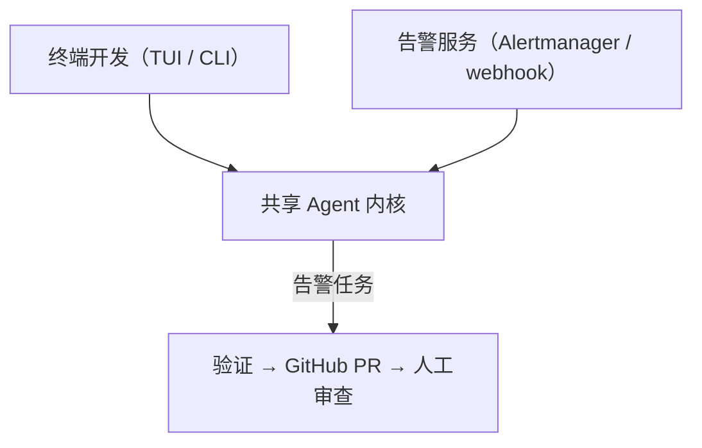

<div align="center">

# MewCode

**Interactive Coding Agent & Alert-Driven Repair Service**

[](https://github.com/pretextQ/MewCode/actions/workflows/ci.yml)
[](pyproject.toml)
[](LICENSE)
[](https://hub.xerj.org/contributors/pretextQ)

[安装](#10-installation) · [快速开始](#11-quick-start) · [告警服务](#122-告警服务配置) · [文档](guides/README.md)

</div>

---

## 一句话

> **MewCode** 是一个开源 AI 编程助手，也能在隔离工作区中尝试修复告警关联的问题，验证变更并提交 GitHub PR 供人工审查。

---

## 1. Overview

MewCode 提供 Textual 终端界面（TUI）、单次 CLI 命令和无头告警服务。三个入口共享同一套 Agent 内核、模型接口和工具权限。你可以在终端中探索仓库、编辑代码和运行测试，也可以为指定仓库接入 Alertmanager，让服务接手复现、修复与验证。

## 2. Why MewCode

- **交互开发和告警修复共享内核**。终端会话与服务任务使用相同的文件编辑、命令执行和上下文管理能力。
- **修复任务与日常开发隔离**。服务为任务创建独立 Git worktree，默认在 Docker 容器里运行修复。
- **验证结果可以追溯**。PR 和任务报告记录本地验证对应的源码树、发布提交和验证范围。
- **发布后交接给人**。服务跟踪远端 CI，评审者可以要求返工或升级处理，实际合并由人执行。

## 3. Core Capabilities

| 能力 | 功能 |
| --- | --- |
| 终端工作台 | 流式对话、会话恢复、编辑 diff、按需查看 Git 状态和变更。详见 [TUI 指南](guides/tui.md)。 |
| Agent 工具 | 文件读写与搜索、Shell、上下文压缩、子代理和任务管理。详见 [Agent 运行契约](guides/agent-runtime.md)。 |
| 项目规则与扩展 | 目录链项目指令、Skills、Hooks，以及 stdio 和 Streamable HTTP MCP。详见 [项目指令](guides/project-instructions.md)、[Hooks](guides/hook-contract.md) 和 [MCP](guides/mcp-loading.md)。 |
| 告警接入与交接 | Alertmanager 或 webhook 手动触发、SQLite 原子去重、有界队列、人工返工和重启恢复。详见 [服务交接与恢复](guides/service-reliability.md)。 |
| 诊断与观测 | 任务报告、Prometheus 指标、模型 token 统计和进程诊断日志。详见 [进程诊断](guides/diagnostics.md)。 |

## 4. Architecture



共享内核负责模型调用、权限检查和工具调度。告警服务为每个修复任务创建独立 Git worktree，默认在 Docker 中执行，并在发布 PR 后跟踪 CI。详见 [架构与生命周期](guides/architecture.md)。

## 5. Bug-fixing Workflow

```text
告警接入 → 排查 → 复现与基线测试 → 修改代码 → 本地验证 → 发布 PR → 观察 CI → 人工审查
```

- **接入与复现**。服务按仓库策略受理告警，将相同指纹的告警去重，并在任务 worktree 中执行已配置的基线测试。
- **修复与重试**。Agent 根据告警和失败信息生成变更。验证或 CI 失败时按预算重试，默认最多三次自动修复尝试。预算耗尽后升级人工处理。
- **评审与返工**。`human_review` 表示等待人工处理。评审者可通过 decision 接口记录 `changes_requested`、`escalate`，或在实际合并后记录 `merged`。返工复用任务工作区。
- **状态与通知**。任务记录每次执行和状态变化。通知通过 Outbox 独立补发，待人工审查的任务在重启后保持等待。详见 [服务交接与恢复](guides/service-reliability.md)。

## 6. Demo

配置模型后，在项目目录运行一次只读分析任务。

```bash
uv run mewcode -p "概括仓库结构并指出主要入口" --mode plan --output-format json
```

JSON 摘要包含 `result`、`usage`、`toolCalls` 和 `sessionId`。告警服务的交付示例见 [演示 PR](https://github.com/pretextQ/mewcode-alert-demo/pull/5) 和 [历史回放](docs/history/replay-2026-10-05.md)。回放记录的是演示仓库中从告警到人审的样本，采用宿主执行并跳过集成验证。

需要搭建专用演示仓时，可使用 [m1_demo.py](scripts/m1_demo.py) 生成故障场景和模拟告警，或使用 [m3_replay.py](scripts/m3_replay.py) 批量回放。脚本会修改演示仓库，回放可能推送远端分支。

## 7. Model Backends

在 `providers` 中配置模型名称、端点和协议。配置多个模型时，TUI 启动时提供选择，单次命令和告警服务使用列表第一项。

| `protocol` | 接口 | `api_key` 留空时读取 |
| --- | --- | --- |
| `anthropic` | Anthropic Messages | `ANTHROPIC_API_KEY` |
| `openai` | OpenAI Responses | `OPENAI_API_KEY` |
| `openai-compat` | OpenAI 兼容 Chat Completions | `OPENAI_API_KEY` |

协议按端点实际支持的接口选择。也可在 `api_key` 中用 `${变量名}` 引用自定义环境变量。更多字段见 [配置示例](.mewcode/config.example.yaml)。

## 8. Safety Guards

- **工具权限**。`default` 对常规写入和命令请求确认，`acceptEdits` 自动接受常规文件编辑。`dontAsk` 允许常规工具操作，仍执行显式拒绝规则、危险命令检查、路径约束和配置及技能文件写保护。非交互模式会拒绝需要确认的操作。详见 [权限语义](guides/permission-semantics.md)。
- **服务隔离**。默认容器使用非 root 用户、只读根文件系统、capability 丢弃、禁止提权、资源限额和硬超时。沙箱不可用时默认拒绝执行，宿主回退需显式启用。普通 CLI 和 TUI 在宿主上执行 Shell。
- **服务鉴权**。非回环监听要求配置 `service.webhook_token`。配置后，除最小健康探针外的 API 请求必须提供 `X-MewCode-Token` 或 `Authorization: Bearer <token>`。
- **扩展与监督**。服务只挂载声明为只读的 MCP 工具。独立审查和循环监督可单独启用，默认关闭。详见 [独立审查](guides/independent-review.md) 和 [监督指南](guides/supervision.md)。

## 9. Verification

1. **本地验证绑定源码树**。服务对照按 Git 发布规则计算的候选树，核对单测、适用的集成验证和最终提交。阶段检查发现源码变化时，服务使验证证据失效并升级人工处理。
2. **pytest 范围对照**。对可识别的 pytest 命令，记录基线和修复后的用例、执行结果与配置变化。用例减少、仅收集、增加跳过或改写原有测试会提示人工核对。出现 `review_required` 时，记录人工合并决定还需提交当前发布 SHA 和理由。
3. **CI 绑定发布提交**。服务按发布 SHA 查询 CI。未配置、跳过或无法取证的验证分别记录在任务报告中。评审人可在 `GET /jobs/{id}/report` 查看 `verification.revisions` 和 `verification.pytest_scope`。

源码树核对覆盖 Git 将要发布的内容和各验证阶段边界。pytest 范围对照适用于直接调用 `pytest`、`python -m pytest` 及可识别的 `uv run` 形式。详见 [服务验证契约](guides/service-reliability.md#本地验证与发布版本) 和 [专项验收](docs/acceptance/stage-2026-11-18-service-verification.md)。

## 10. Installation

需要 Python 3.11+、Git 和 [uv](https://docs.astral.sh/uv/)。运行默认隔离的告警服务还需 Docker。

```bash
git clone https://github.com/pretextQ/MewCode.git
cd MewCode
uv sync --locked
```

## 11. Quick Start

在项目根目录创建 `.mewcode/config.yaml`。将 `base_url`、`model` 和 `protocol` 换成你的模型端点对应的值。

```yaml
providers:
  - name: my-provider
    protocol: anthropic
    base_url: https://your-provider.example/anthropic
    model: your-model-name
    api_key: "${MEWCODE_MODEL_API_KEY}"
```

在当前终端设置密钥，然后启动 TUI。

```powershell
# PowerShell
$env:MEWCODE_MODEL_API_KEY = "填入你的密钥"
uv run mewcode
```

```bash
# Bash
export MEWCODE_MODEL_API_KEY="填入你的密钥"
uv run mewcode
```

Windows 也可以从 MewCode 根目录运行带终端恢复的启动器。传入目标目录时，启动器默认使用 MewCode 仓库里的 `.mewcode/config.yaml`（如存在）。用 `-Config <path>` 可覆盖配置路径。

```powershell
.\mew
.\mew "D:\projects\你的项目"
```

在 TUI 中用 Enter 发送，Shift+Enter 或 Ctrl+J 换行。F2 打开开发详情，Ctrl+End 返回最新消息，Ctrl+O 展开或收起工具输出。运行中按 Ctrl+C 请求停止，空闲时按 Ctrl+C 退出。详见 [TUI 指南](guides/tui.md)。

## 12. Configuration

### 12.1. 配置文件

默认按 `~/.mewcode/config.yaml` → 当前目录 `.mewcode/config.yaml` → `.mewcode/config.local.yaml` 的顺序读取，并按配置项的合并规则处理。用 `--config <path>` 可以改为读取指定文件。模型和 GitHub 凭据可通过环境变量提供。实际凭据应保存在本地。

| 配置 | 默认值 | 用途 |
| --- | --- | --- |
| `permission_mode` | `default` | 工具权限，也可用 `--mode` 指定 |
| `mcp_loading` | `legacy` | 工具加载模式，可选 `eager`、`dispatch`、`auto` |
| `enable_supervision` | `false` | 启用 CLI/TUI 的监督机制 |
| `service.enable_supervision` | `false` | 启用服务任务的监督机制 |
| `service.host` / `service.port` | `127.0.0.1` / `8321` | HTTP 监听地址和端口 |
| `service.sandbox.enabled` | `true` | 启用容器隔离 |
| `service.token_budget` | `0`（不限） | 单个任务的模型 token 预算 |

### 12.2. 告警服务配置

在模型配置所在的文件中加入 `service`。准备目标仓库的本地 checkout、可用的容器运行时和具备推送与创建 PR 权限的 GitHub 凭据。替换示例中的仓库路径、远端、目标分支及测试命令，并在当前终端设置 `GITHUB_TOKEN`。将 `webhook_token` 的值替换成实际用于鉴权的 token，保存在本地配置中。

```yaml
service:
  host: 127.0.0.1
  port: 8321
  webhook_token: "replace-with-your-webhook-token"
  token_budget: 500000
  vcs:
    provider: github
    token: "${GITHUB_TOKEN}"
  repos:
    demo:
      path: /absolute/path/to/demo-repo  # Windows 例如 D:/projects/demo-repo
      url: https://github.com/you/demo-repo.git
      base_branch: main
      test_command: python -m pytest
  sandbox:
    enabled: true
    allow_host_fallback: false
```

```bash
uv run mewcode serve
```

如果采用容器运行 `python -m pytest`，在目标仓库的 `requirements.txt` 中声明 pytest 和其他测试依赖。

| 端点 | 用途 |
| --- | --- |
| `POST /webhook/alert` | 接收 Alertmanager 告警 |
| `POST /webhook/manual` | 通过 JSON 手动触发，`repo` 对应 `service.repos` 中的仓库名 |
| `GET /jobs`、`GET /jobs/{id}/report` | 查看任务、执行记录、策略、通知与验证证据 |
| `POST /jobs/{id}/decision` | 记录人工决定或发起返工 |
| `GET /metrics`、`GET /costs?repo=demo` | 查看 Prometheus 指标和原始 token 数量 |
| `GET /healthz` | 查看健康状态 |

按仓库覆盖严重度路由、分支、预算和通知时，使用目标仓库下的 `.mewcode/policy.yaml`。详见 [完整配置示例](.mewcode/config.example.yaml) 和 [服务运行指南](guides/service-reliability.md)。

## 13. Testing

```bash
uv run --locked pytest -q --maxfail=10 --timeout=120
uv run --locked ruff check .
uv run --locked python scripts/engineering_guards.py
```

默认测试使用替身模型和外部服务，无需 API 密钥。CI 在 Windows、Ubuntu 的 Python 3.11 和 3.13 上运行，并单独执行权限安全回归和依赖审计。真实 Docker 专项通过 `MEWCODE_DOCKER_TESTS=1` 启用。环境隔离、真实模型验证和完整检查见 [开发指南](guides/development.md)，历次结果见 [验收档案](docs/acceptance/README.md)。

## 14. Project Structure

```text
MewCode/
├── mewcode/
│   ├── __main__.py    # CLI、TUI 与服务入口
│   ├── agent.py       # 共享 Agent 执行循环
│   ├── client.py      # 模型协议适配
│   ├── tui/           # 终端界面组件
│   ├── tools/        # 文件、搜索、Shell 与子代理工具
│   ├── permissions/  # 工具权限和路径保护
│   └── service/      # 告警、沙箱、验证与 PR 交付
├── .mewcode/         # 示例配置
├── tests/            # 回归测试
├── scripts/          # 启动、检查和演示入口
├── guides/           # 使用与开发指南
└── docs/             # 项目状态、设计和验收记录
```

## 15. Limitations

- **容器网络与 Compose**。容器支持 `bridge` 和 `none` 网络，当前没有细粒度域名出口规则。Compose 依赖仅支持经过校验的配置子集。
- **验证范围**。命令包装器、分布式收集和集成测试的覆盖范围需单独核对。历史演示和回放只覆盖各自样本。
- **平台验收**。Windows 和 Linux 是当前验收目标，GUI 终端人工矩阵仍待完成。Linux 进程树回收曾有偶发失败，根因待确认。
- **协议兼容性**。MCP 的 `native/tool_reference` 与外部端点缓存收益仍待独立验证。详见 [维护待办](docs/backlog.md)。

## 16. Roadmap

当前候选方向包括 token 预算预警、GitHub 评审反馈触发返工、PR 发布队列持久化，以及独立审查的更大规模效果评估。进度和验收边界见 [维护待办](docs/backlog.md) 与 [设计索引](docs/evolution/README.md)。

## 17. License

MewCode 使用 [MIT 许可证](LICENSE)。

---

## Contributing

贡献前请阅读 [项目约定](MEWCODE.md) 和 [开发指南](guides/development.md)。了解当前交付状态和文档组织方式，请查阅 [文档索引](docs/README.md)。
